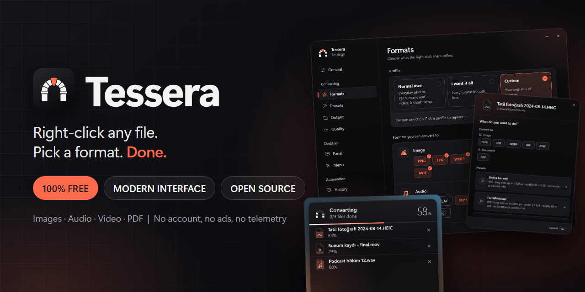
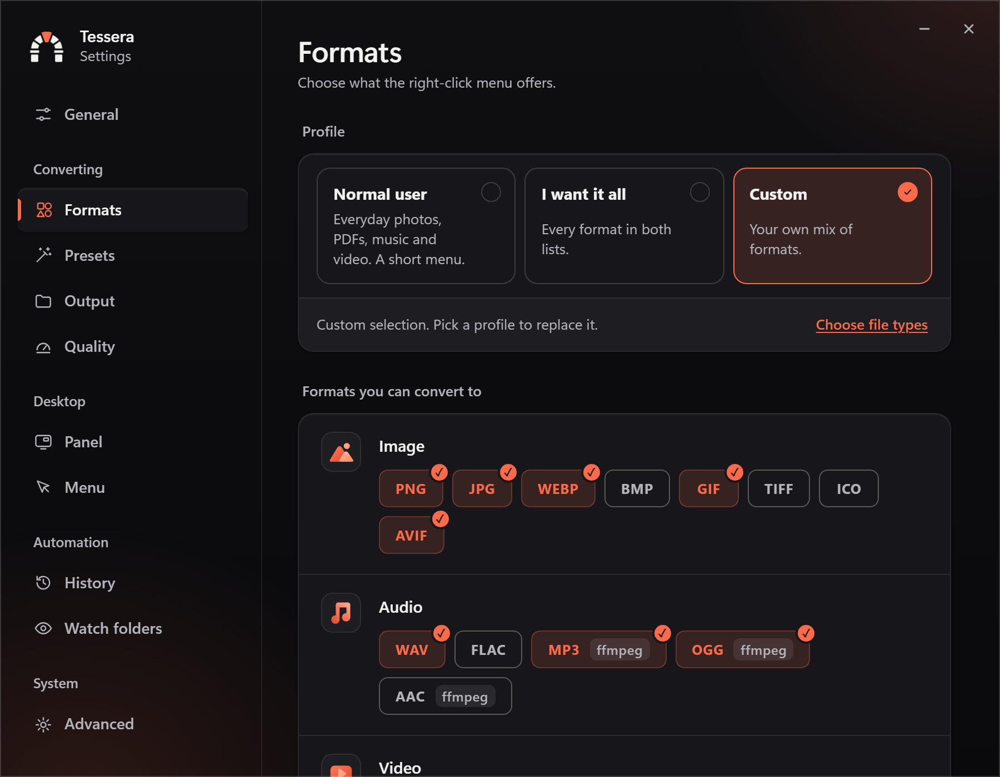
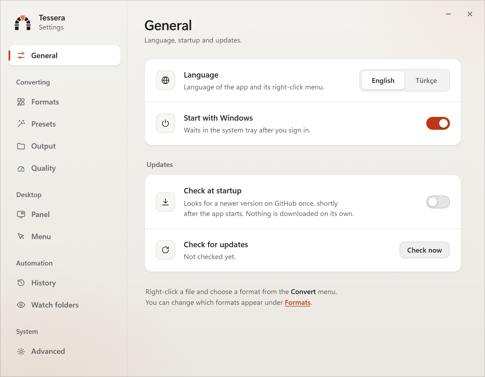
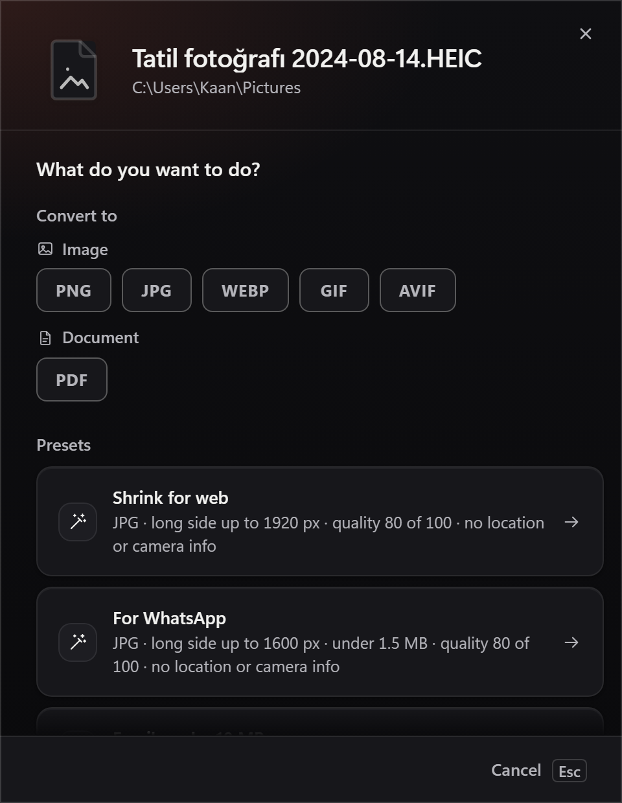
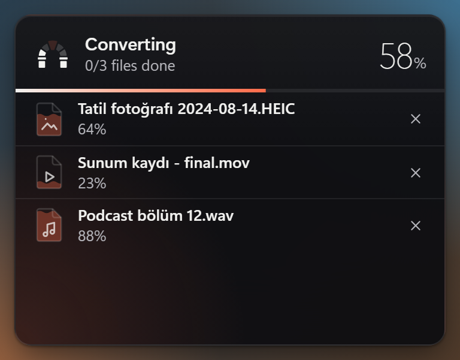
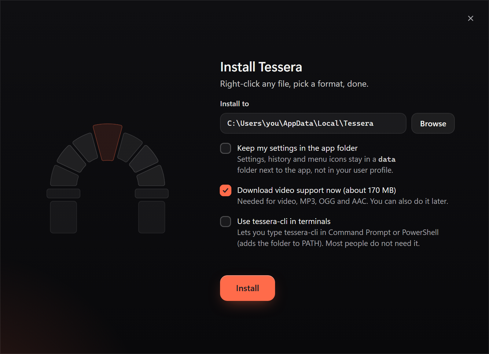
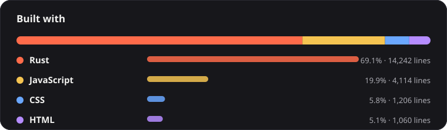

<p align="center"></p>

# Tessera

**Right-click any file, pick a format, done.** Tessera is a **100% free**, open-source file converter with a **modern interface**. It lives in the Windows right-click menu, turns photos, audio, video and PDFs into the format you need, shrinks them for email or WhatsApp, and never sends a file anywhere.

- **Free, for real:** MIT licensed. No price, no subscription, no premium tier, no account, no ads, no telemetry, no admin rights.
- **Modern interface:** a clean, fast window in dark and light, smooth motion, keyboard friendly, English and Turkish. Built for Windows 10 and 11.

Most converter apps cost money, run on subscriptions or bury the exit under upsells, and all of them do the same job: decode a file and encode it again. Tessera does that on your own machine, from the Explorer menu you already use. There is nothing to buy and nothing to unlock.

## A look

<table>
<tr>
<td width="50%"><br><sub><b>Settings.</b> Choose what the menu offers.</sub></td>
<td width="50%"><br><sub><b>Light and dark.</b> Both are finished, not an afterthought.</sub></td>
</tr>
<tr>
<td> <br><sub><b>Chooser and progress panel.</b> Pick a format or preset, watch every file.</sub></td>
<td><br><sub><b>One-file installer.</b> No setup wizard, no admin rights.</sub></td>
</tr>
</table>

## How it works

1. Right-click a file (or several, or a folder) and open **Tessera**.
2. Pick a format or a preset, such as "Email: under 10 MB".
3. A small panel shows the progress. The original stays untouched and the result lands next to it.

Prefer a window? Drop files on it and choose there. Prefer scripts? There is a full command line.

## What you can do

- **Convert:** PNG, JPG, WEBP, GIF, BMP, TIFF, ICO, AVIF, PDF; WAV, FLAC, MP3, OGG, AAC; MP4, MKV, AVI, WEBM, MOV. It also reads SVG, HEIC, RAW (embedded preview) and PDF pages, and turns animated GIFs into MP4 or WebM.
- **Shrink to a size:** "under 10 MB" or "under 2 MB" for images, video, audio and PDF. A file that already fits is copied as is when its format stays the same.
- **Presets:** web, WhatsApp, email, Discord (all under 10 MB where it matters), strip location data, PDF, WebP, icon, Instagram, podcast. Save your own from any custom settings.
- **Edit on the way:** resize, strip metadata, fix orientation, cut audio and video, audio bitrate, mono, GIF fps and width.
- **Batch:** merge images into one PDF or audio files into one, convert whole folders, drop many files at once.
- **Automate:** watch folders with rules, a Send To entry, and `tessera-cli` for scripts.
- **Move your setup:** export all settings, presets and watch rules to a file and import them on another PC.
- **Stay safe:** originals are kept, output gets a new name, nothing is overwritten unless you turn it on. Every job goes into a history with undo, and any running job can be cancelled.
- **Feel at home:** English and Turkish (follows Windows), light and dark, keyboard friendly.

Images, audio and PDF are converted in pure Rust, no extra tools. Video, MP3, OGG, AAC and HEIC use ffmpeg, which the installer can download for you (see below).

## Install

Windows 10 or 11. Needs Microsoft Edge WebView2, which both already include.

Get `tessera-setup-v0.1.2.exe` from the [latest release](https://github.com/kaan0d/Tessera/releases/latest) and double-click it. Each release lists the exe's SHA-256. The exe is its own installer, so there is nothing else to download. Pick a folder (default `%LOCALAPPDATA%\Tessera`) and let it download video support with a live percentage. It also registers the menu, a Start menu shortcut and an uninstall entry. Uninstall from Settings > Apps > Tessera.

The exe is not code-signed yet, so SmartScreen may ask you to confirm once (More info, then Run anyway).

For a silent install:

```
tessera.exe --install D:\Apps --add-to-path              adds \Tessera to the folder
tessera.exe --uninstall --quiet                          --keep-data keeps settings
```

Both exit 0 on success and 1 on failure. `--install` downloads ffmpeg unless it is already there; add `--defer-ffmpeg` to skip it.

## Command line

```
tessera-cli convert photo.heic --to jpg
tessera-cli convert scan.png --to webp --max-edge 1600 --strip
tessera-cli convert clip.mov --to mp4 --max-size 8MB
tessera-cli convert talk.mp4 --to mp3 --start 1:30 --end 4:00 --mono
tessera-cli preset whatsapp beach.jpg --out D:\Sent
tessera-cli merge pdf page1.png page2.png page3.png
tessera-cli list-presets
tessera-cli formats png
```

`tessera-cli.exe` sits next to `tessera.exe` and is the same tool flagged as a console program, so PowerShell and cmd wait for it and see the exit code. It takes folders and `*.png` patterns, `--recursive`, `--dry-run`, `--json` and `--quiet`. Exit codes: 0 ok, 1 a file failed (or every file was skipped), 2 usage error. `merge audio ... --to mp3` joins audio, `--max-size` keeps a merged PDF small. `tessera-cli --help` lists everything.

## Privacy

Files never leave your computer. Tessera downloads one thing: a pinned LGPL ffmpeg build (about 170 MB, SHA-256 checked) during setup. Untick it there, or choose Later in the app, and nothing is fetched until you press Download. The update check is off until you turn it on; "Update now" then downloads the new installer from the release, checks its SHA-256 and replaces the app, keeping your settings.

On disk, in the `data` folder inside the install folder: `settings.json`, `history.json` (your last 200 jobs with their file paths, switch it off under History) and `tessera.log` (failed jobs with file names, 512 KB at most).

Everything is per user. Files: the install folder only, data included (an update from v0.1.x moves the old `%APPDATA%\Tessera` into it). Registry, all under `HKCU`: the Explorer menu keys, the uninstall entry, and optionally `Run` (Start with Windows) and the user `Path`. Uninstalling removes all of it; settings and history go too if you tick that box. Converted files are never touched.

## Limits

- Windows 11 shows classic menus under "Show more options".
- The installer is not code-signed, so SmartScreen may warn on first run.
- A full-screen exclusive game hides the progress panel.
- RAW files use the embedded JPEG preview, not a full demosaic.

## Built with

<p align="center"></p>

A Rust engine does the converting and runs the menu, the queue, the watchers and the installer. The window is plain HTML, CSS and JavaScript with no framework and no bundler, hosted by [Tauri 2](https://tauri.app) and the WebView2 that Windows already has, which is why the whole app is one small exe. The app speaks English and Turkish.

## License

MIT. Third-party notices are in `THIRD-PARTY-LICENSES.md`.

---

## For developers

Tessera is Tauri 2 with a Rust backend and a vanilla JS front end (no framework, no bundler). Issues and pull requests are welcome. Report security problems privately through GitHub's "Report a vulnerability" on the repository.

**Build and run** (Windows, Rust stable):

```
cd src-tauri
cargo build --release          target\release\tessera.exe, the installer and the app in one exe
cargo run                      debug build: skips the installer, opens the app (use --setup to force it)
cargo test
cargo clippy --all-targets     keep both clean
```

The UI in `src/` is served as is, so edit it and reload. A running exe locks its file: close Tessera before building. A debug build registers its menu in your user registry on first run and points it at that exe; remove it with `tessera.exe --remove-menu`.

**Layout**

```
src/                     UI: index.html (settings), drop.html (chooser), progress.html (panel),
                         install.html (setup window); app.js, drop.js, progress.js, install.js,
                         features.js, i18n.js, style.css
src-tauri/src/
  convert/               engine: image, audio, pdf, svg, raw, ffmpeg, size search, merge, output naming
  queue.rs  batch.rs     job queue, progress events, history records
  shell/                 Explorer menu: registry verbs, icons, presets
  watch.rs  folder.rs    watch folders and folder verbs
  cli.rs  headless.rs    command-line parsing and the `tessera-cli` commands
  install.rs             the self-installer and uninstaller
  settings.rs  preset.rs history.rs  update.rs  log.rs  i18n.rs  ffmpeg.rs
src-tauri/menu-icons/    one .ico per menu verb (embedded in the exe)
```

**Things worth knowing**

- **Two languages, two files:** UI strings live in `src/i18n.js`, Rust strings in `src-tauri/src/i18n.rs`. A new key needs both English and Turkish, so keep the two in step.
- **No inline styles:** the content security policy is `default-src 'self'`, so style with classes in `style.css` (colors are tokens on `:root`).
- **Conversion rules:** every converter writes through `output::write_atomic`, never overwrites the source, and honors the size limit through `size::fit` or ffmpeg bitrates. New formats go in `convert/mod.rs` (`Format`, `supported_targets`).
- **Menu icons:** bump `ICON_REV` in `shell/mod.rs` when you change an icon so Explorer drops its cache.
- **Releases:** `cargo build --release` produces `target/release/tessera.exe`, and that exe is the installer, so there is no bundle step. Publish it as `tessera-setup-vX.Y.Z.exe` plus `tessera-setup-vX.Y.Z.exe.sha256` (`gh release create vX.Y.Z tessera-setup-vX.Y.Z.exe tessera-setup-vX.Y.Z.exe.sha256`). The in-app update check and "Update now" read the latest release of this repo and need both assets under exactly these names.
- **Build output:** `src-tauri/target` grows past 10 GB and `src-tauri/gen` is generated. Both are git-ignored and safe to delete; the next build recreates them.
